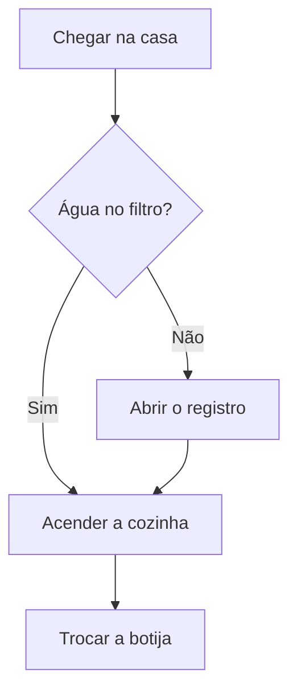
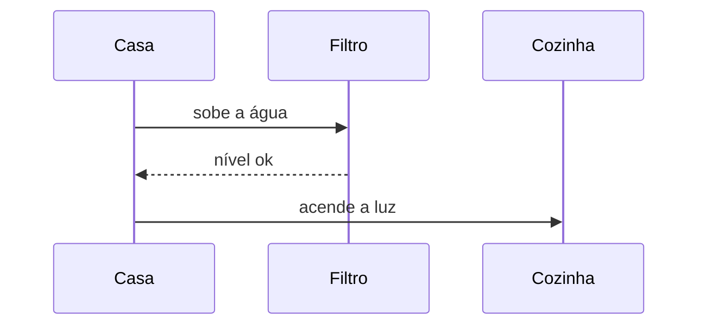

# Casa do fim de semana

O cenário de acessibilidade continua colorido. Os desenhos desta página saem dos blocos mermaid.

## Acessibilidade

```gherkin
@RN19 @T4 @T5 @T6 @E1 @E2 @E3 @ui @a11y
Cenário: C11 Anunciar estados e resultados para leitor de tela
  Dado que o usuário usa leitor de tela
  Quando o app exibe o código preenchido, a confirmação de aceite ou um erro
  Então o estado ou resultado é anunciado de forma compreensível
  E as ações disponíveis têm nome acessível
  E o erro não depende só de cor ou ícone
```

## Chegada



## Recados da estrada


