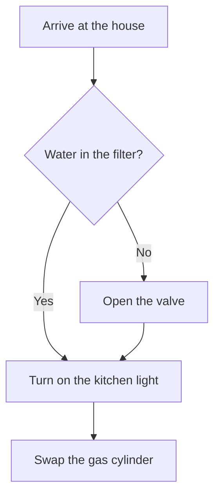
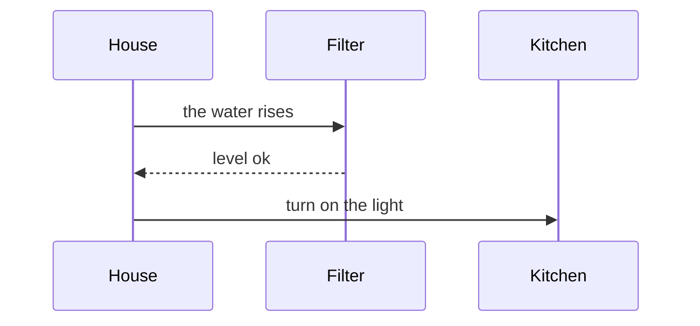

# Weekend house

The accessibility scenario stays colored. The drawings on this page come from mermaid fences.

## Accessibility

```gherkin
@RN19 @T4 @T5 @T6 @E1 @E2 @E3 @ui @a11y
Scenario: C11 Announce states and results to a screen reader
  Given the user is using a screen reader
  When the app shows the filled code, the acceptance confirmation, or an error
  Then the state or result is announced in a way that can be understood
  And the available actions have an accessible name
  And the error does not depend only on color or an icon
```

## Arrival



## Notes from the road


